# Mini-CMS

## Description

Mini-CMS est une application web complète développée avec Laravel 12/13 et Tailwind CSS dans le cadre de l'Atelier Framework Côté Serveur (ISET Sidi Bouzid). Le projet implémente un système complet de gestion d'articles avec catégorisation, étiquetage (tags), gestion des auteurs, un espace d'administration sécurisé, ainsi qu'une API REST complète protégée par jetons d'authentification Laravel Sanctum.

## Fonctionnalités

- **Gestion des articles** : Consultation publique des articles publiés, pagination, filtrage par catégorie et par tag, archivage par année.
- **Espace Auteur** : Création, modification, prévisualisation et suppression d'articles personnels avec gestion fine des autorisations via `PostPolicy`.
- **Espace Administration** : Gestion complète (CRUD) des catégories et des tags réservée aux administrateurs via middleware dédié.
- **Authentification & Rôles** : Inscription, connexion, déconnexion avec gestion de rôles (`admin` et `author`).
- **API REST JSON** :
  - Consultation des articles avec pagination (`/api/posts`), filtrage par catégorie (`?category=slug`) et par tag (`?tag=slug`).
  - Consultation détaillée d'un article (`/api/posts/{post}`).
  - Consultation des catégories (`/api/categories`) et des tags (`/api/tags`) avec décompte des articles publiés associés (`posts_count`).
  - Authentification par jetons personnels Sanctum (`/api/login`, `/api/logout`).
  - Opérations d'écriture protégées sur les articles (`POST`, `PUT/PATCH`, `DELETE` sur `/api/posts`).
- **Conception robuste** : Détection automatique des requêtes N+1 via `Model::preventLazyLoading()`, validation par Form Requests en français, tests automatisés avec Pest.

## Installation

### Bash

```bash
git clone https://github.com/fisuu700/mini-cms.git
cd mini-cms
composer install
npm install
npm run build
cp .env.example .env
php artisan key:generate
php artisan migrate:fresh --seed
php artisan test
composer run dev
```

### PowerShell

```powershell
git clone https://github.com/fisuu700/mini-cms.git
cd mini-cms
composer install
npm install
npm run build
copy .env.example .env
php artisan key:generate
php artisan migrate:fresh --seed
php artisan test
composer run dev
```

## Comptes de test

Les comptes sont initialisés lors de l'exécution du seeder (`php artisan migrate:fresh --seed`) :

- **Administrateur** :
  - E-mail : `test@example.com`
  - Mot de passe : `password`
  - Rôle : `admin` (accès complet au back-office `/admin/*` et gestion de contenu)
- **Auteurs standards** :
  - 2 utilisateurs supplémentaires générés aléatoirement par la fabrique `UserFactory`
  - Mot de passe par défaut : `password`
  - Rôle : `author`

## API

### Endpoints

| Méthode | URI | Protection | Description |
|---|---|---|---|
| POST | `/api/login` | Public | Authentification et émission d'un jeton Sanctum |
| POST | `/api/logout` | `auth:sanctum` | Révocation du jeton courant |
| GET | `/api/posts` | Public | Liste paginée des articles publiés (`?category=`, `?tag=`, `?per_page=`) |
| GET | `/api/posts/{post}` | Public | Détail d'un article publié |
| POST | `/api/posts` | `auth:sanctum` | Création d'un article |
| PUT/PATCH | `/api/posts/{post}` | `auth:sanctum` | Modification d'un article (réservé à l'auteur ou admin) |
| DELETE | `/api/posts/{post}` | `auth:sanctum` | Suppression d'un article (réservé à l'auteur ou admin) |
| GET | `/api/categories` | Public | Liste des catégories avec `posts_count` |
| GET | `/api/categories/{category}` | Public | Détail d'une catégorie |
| GET | `/api/tags` | Public | Liste des tags avec `posts_count` |
| GET | `/api/tags/{tag}` | Public | Détail d'un tag |

### Authentification par jeton

L'API utilise **Laravel Sanctum**. Pour effectuer des actions d'écriture, obtenez un jeton Bearer en envoyant vos identifiants à `/api/login` :

```json
POST /api/login
{
  "email": "test@example.com",
  "password": "password",
  "device_name": "postman"
}
```

La réponse renvoie le jeton d'accès (`token`). Ce jeton doit être transmis dans l'en-tête HTTP de chaque requête protégée :

```http
Authorization: Bearer <jeton>
```

### Codes d'erreur

- `200 OK` : Requête traitée avec succès.
- `201 Created` : Ressource créée avec succès.
- `204 No Content` : Action exécutée avec succès sans contenu en retour (ex. déconnexion).
- `401 Unauthorized` : Jeton absent, invalide ou expiré.
- `403 Forbidden` : Utilisateur authentifié mais non autorisé à modifier ou supprimer la ressource (géré par `PostPolicy`).
- `404 Not Found` : Ressource introuvable ou brouillon non publié pour un accès non autorisé.
- `422 Unprocessable Content` : Échec de validation des données transmises, avec messages d'erreurs détaillés en français.

### Exemple curl.exe

Déconnexion et révocation du jeton courant :

```bash
curl.exe -X POST -H "Accept: application/json" -H "Authorization: Bearer VOTRE_JETON" http://localhost:8000/api/logout
```

## Captures d'écran

### Session 06
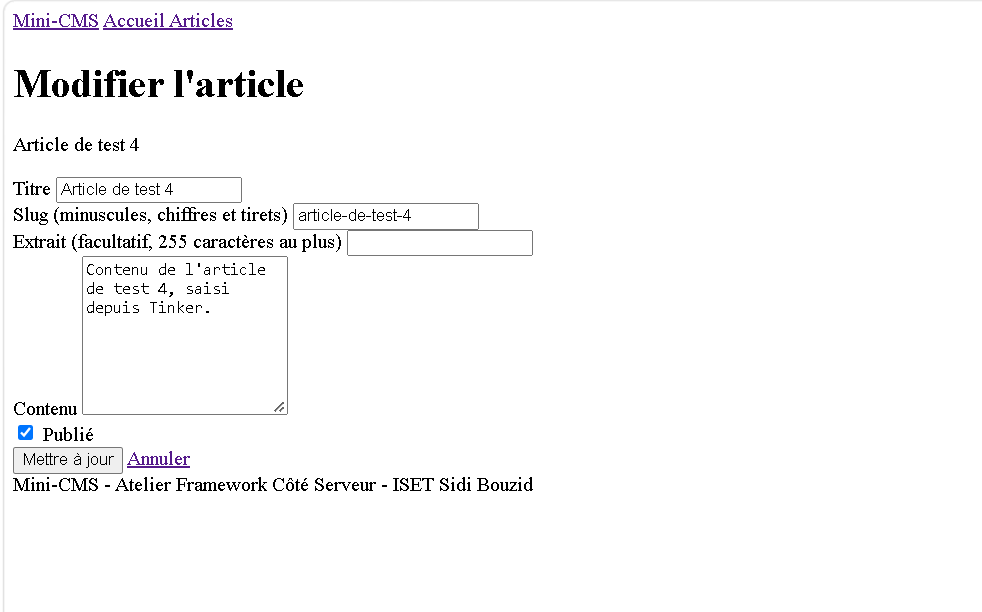
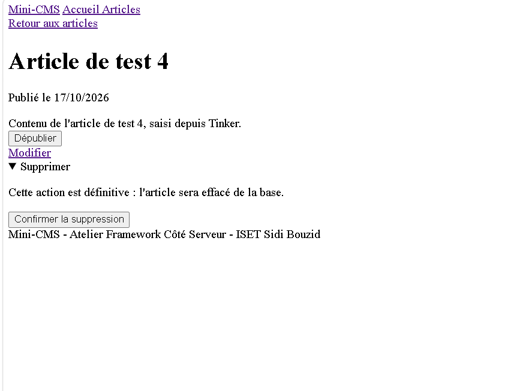

### Session 07

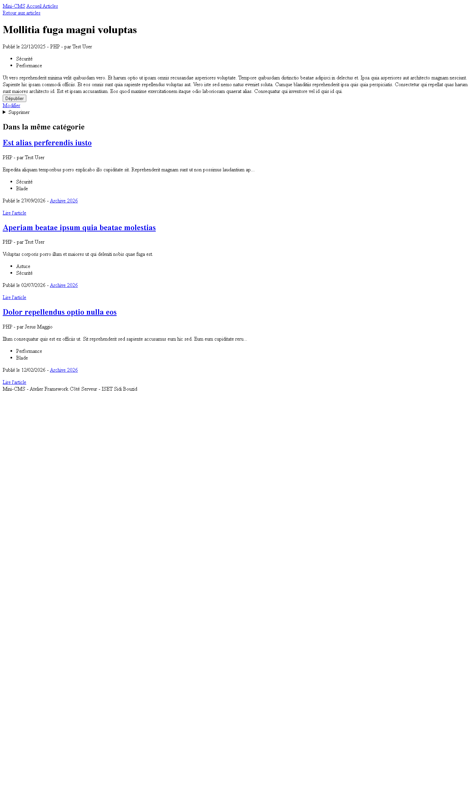

### Session 08

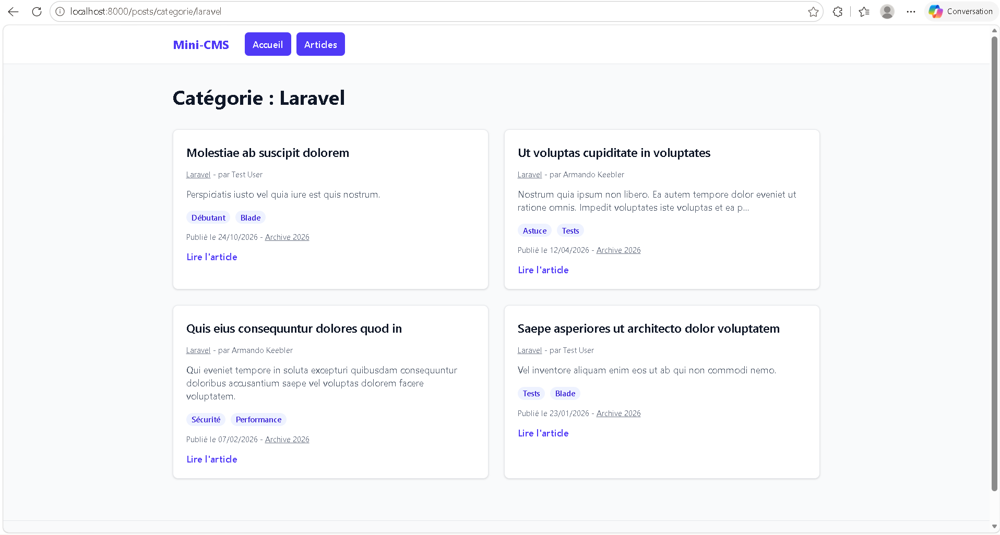

### Session 09
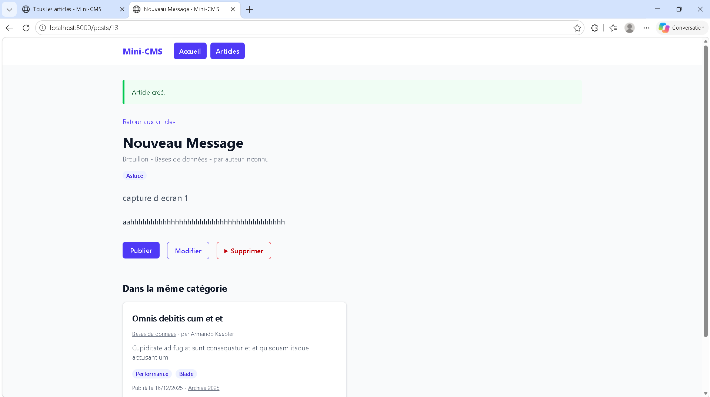
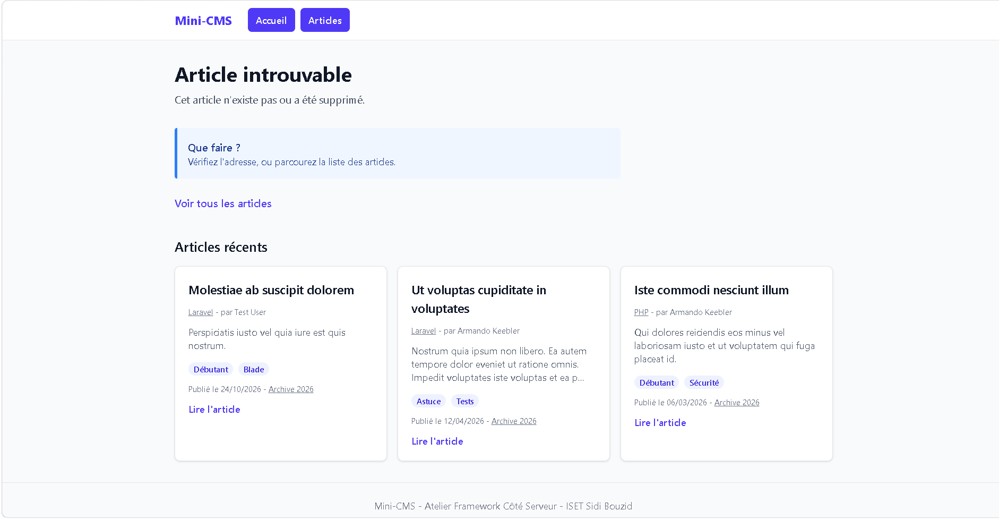

### Session 10

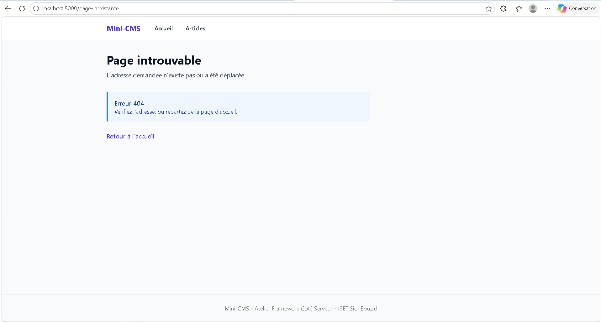

### Session 11


### Session 12
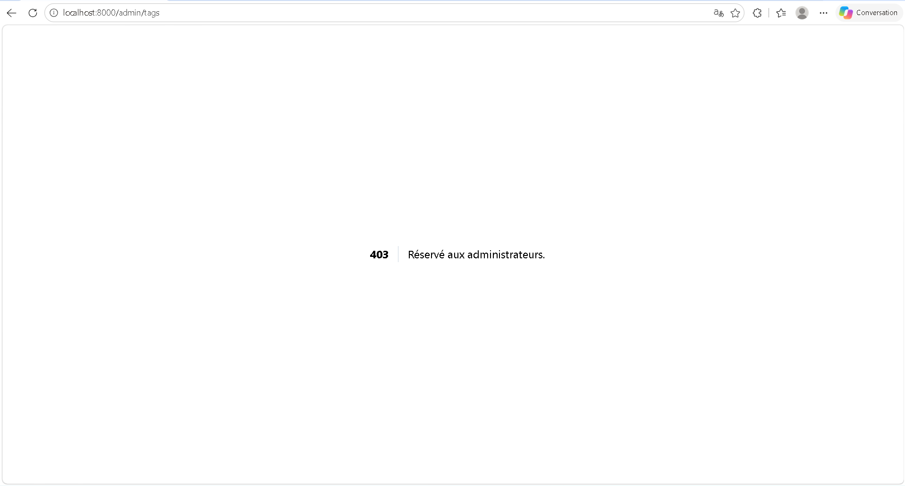
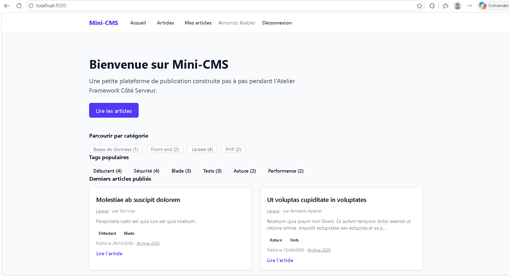

### Session 13
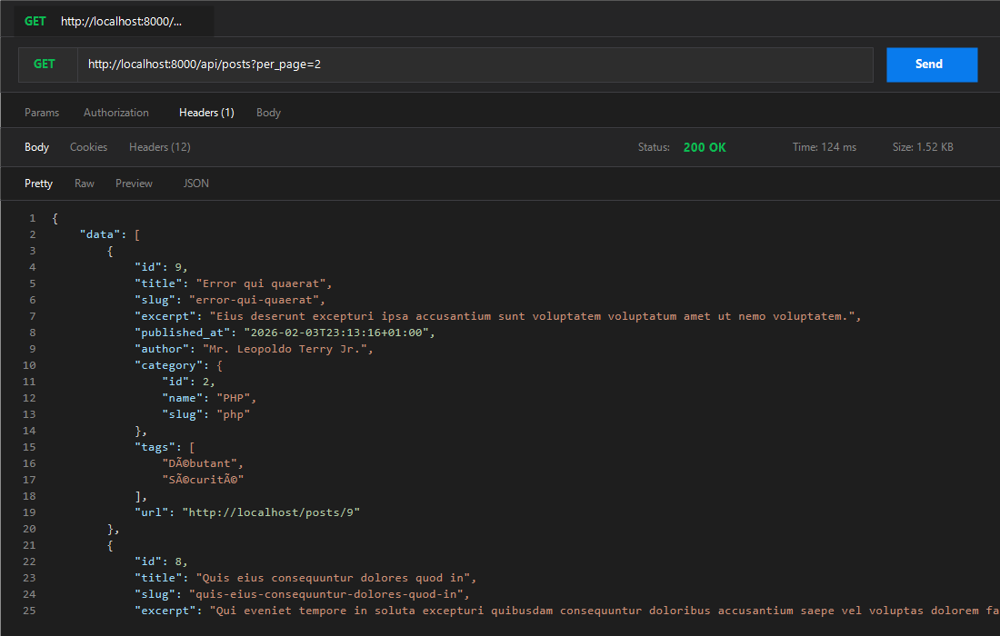
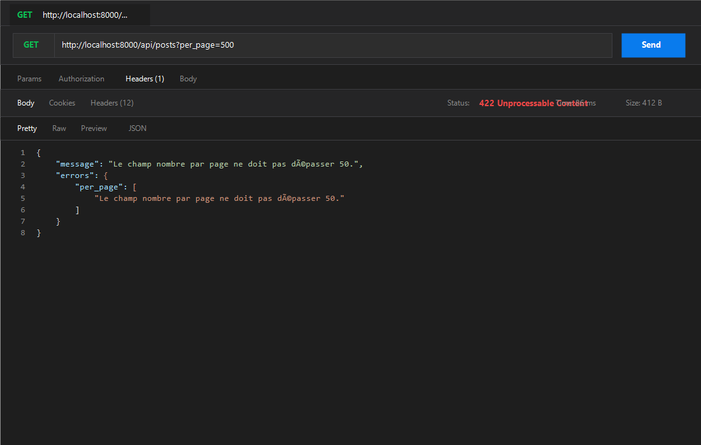

### Session 14
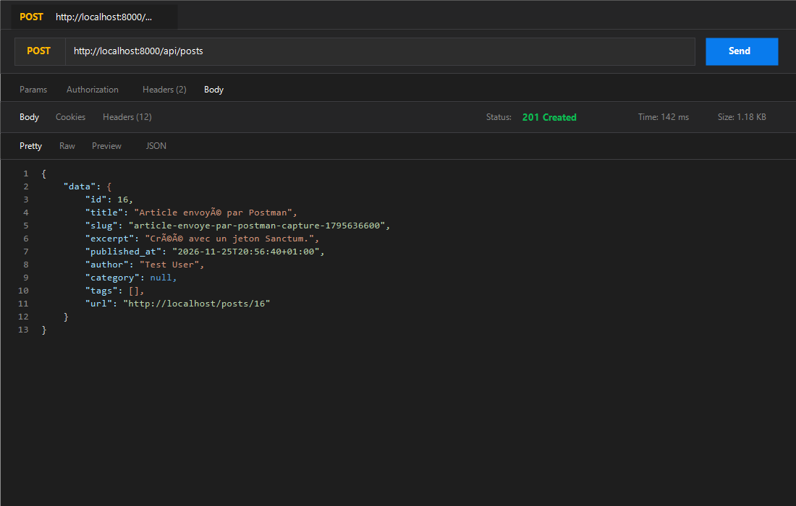
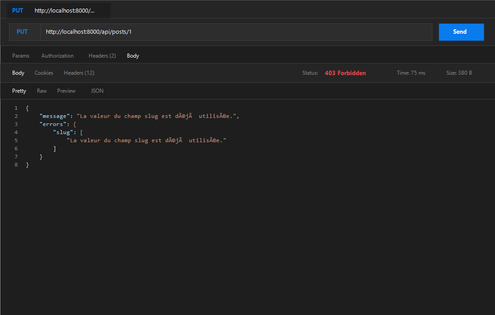

## Choix d'architecture

### Pourquoi les écritures de l'API passent par PostPolicy

L'utilisation de `PostPolicy` centralise l'ensemble des règles métier relatives aux autorisations en un point unique du code. Qu'une requête provienne de l'interface web (formulaires Blade) ou de l'API REST JSON, la même logique détermine si l'utilisateur courant a le droit d'afficher, créer, modifier ou supprimer un article donné. Cette uniformité garantit une sécurité homogène et évite que l'API ne devienne une porte dérobée permettant de contourner les restrictions imposées sur le site web. Si une règle de gestion évolue, la mise à jour de la Policy répercute immédiatement la modification sur l'ensemble des points d'entrée de l'application.

### Pourquoi preventLazyLoading est activé

L'option `Model::preventLazyLoading()` est activée en environnement local de développement afin de détecter et stopper immédiatement le problème de requêtes redondantes dit « N+1 ». Dans une boucle de rendu ou de transformation de ressource, charger des relations de manière différée déclenche une requête SQL supplémentaire pour chaque enregistrement parcouru, ce qui dégrade considérablement les performances de la base de données. En forçant l'application à lever une exception dès qu'un chargement paresseux survient, le développeur est contraint d'utiliser le chargement anticipé (`eager loading` avec `with()` ou `withCount()`). Cette contrainte est désactivée en production pour garantir la continuité de service aux utilisateurs finaux.

### Pourquoi l'API utilise des jetons et non la session

Le protocole HTTP pour les API REST modernes repose sur un fonctionnement sans état (*stateless*). Contrairement à un navigateur web qui conserve un identifiant de session dans un cookie transmis automatiquement, les clients d'API (applications mobiles, microservices, requêtes Postman ou scripts automatisés) interagissent indépendamment des mécanismes de sessions et des protections CSRF du navigateur. L'utilisation de jetons porteurs (*Bearer tokens*) avec Laravel Sanctum permet d'authentifier chaque requête de manière explicite et autonome. De plus, les jetons offrent une granularité supérieure : chaque utilisateur ou appareil dispose de son propre jeton, révocable individuellement sans perturber les autres sessions actives.
