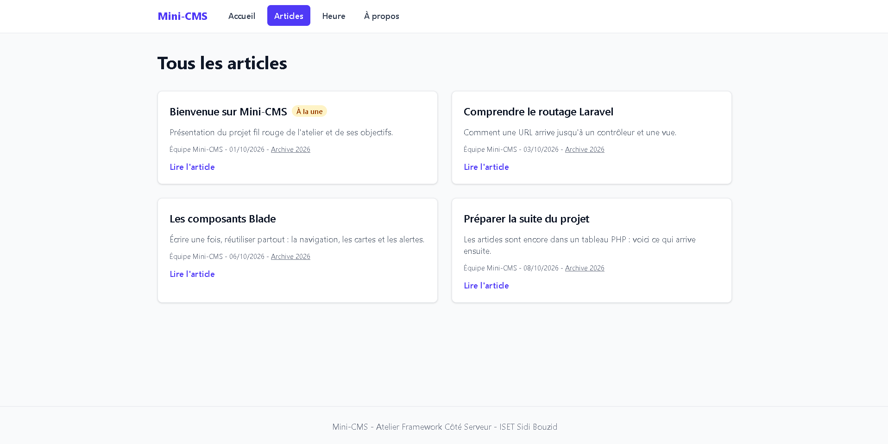

# Mini-CMS

Projet fil rouge de l'Atelier Framework Côté Serveur (Laravel 13, PHP 8.3+), 3e année MDW, ISET Sidi Bouzid.

Auteur : Firas Bouzid, groupe MDW32.

Mini-CMS évolue au fil du semestre vers une petite plateforme de publication : pages publiques, back-office authentifié, API JSON et tests Pest. Chaque session se termine par un tag Git (`lab-01`, `lab-01b`, `lab-02`, etc.).

## État actuel (tag lab-02b)

- Pages construites avec des composants Blade anonymes : `x-navbar`, `x-nav-link`, `x-post-card`, `x-alert`, `x-page-header`.
- Lien actif dans la navigation avec `request()->routeIs()`.
- Articles toujours stockés dans un tableau PHP, sans base de données pour l'instant.

## Routes disponibles

| Méthode | URI | Nom | Action |
|---|---|---|---|
| GET | `/` | `home` | `PageController@home` |
| GET | `/a-propos` | `about` | `PageController@about` |
| GET | `/heure` | `time` | `PageController@time` |
| GET | `/posts` | `posts.index` | `PostController@index` |
| GET | `/posts/archive/{year}` | `posts.archive` | `PostController@archive` |
| GET | `/posts/{slug}` | `posts.show` | `PostController@show` |

## Prérequis

- PHP et Composer (PHP 8.3 ou plus depuis https://www.php.net/downloads, avec les extensions curl, fileinfo, mbstring, openssl, pdo_sqlite, sqlite3 et zip activées dans php.ini, et Composer depuis https://getcomposer.org).
- Node.js LTS et npm.
- Git.

## Installation

### Bash (Git Bash, macOS, Linux)

```bash
git clone https://github.com/fisuu700/mini-cms.git
cd mini-cms
composer install
npm install
cp .env.example .env
php artisan key:generate
touch database/database.sqlite
php artisan migrate
composer run dev
```

## Captures d'écran

### Session 04


