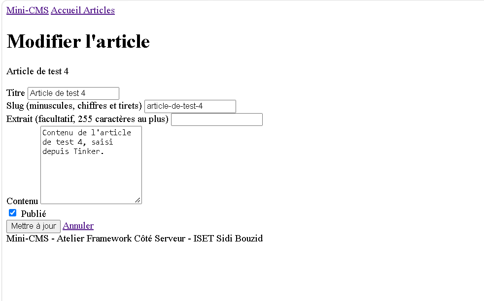
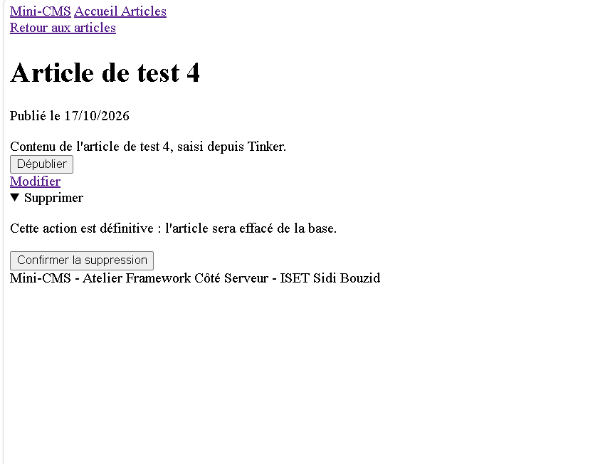
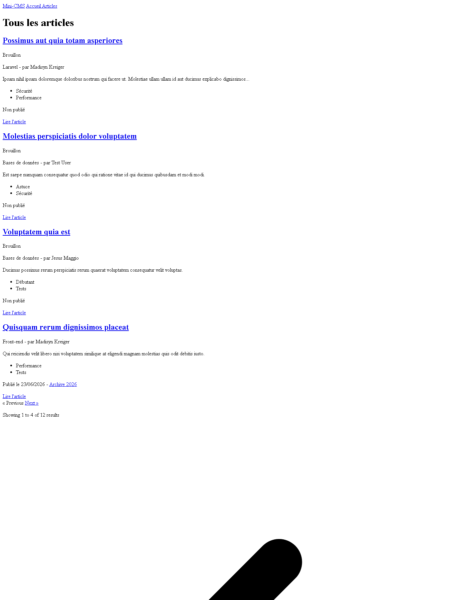
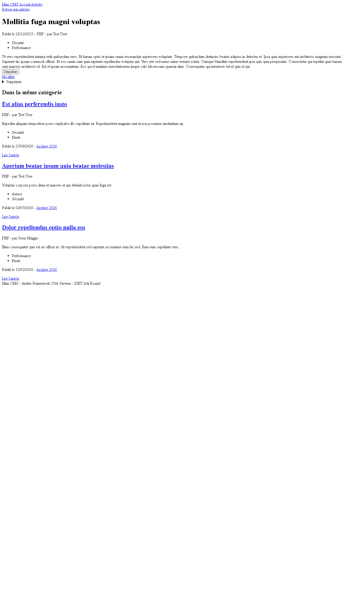
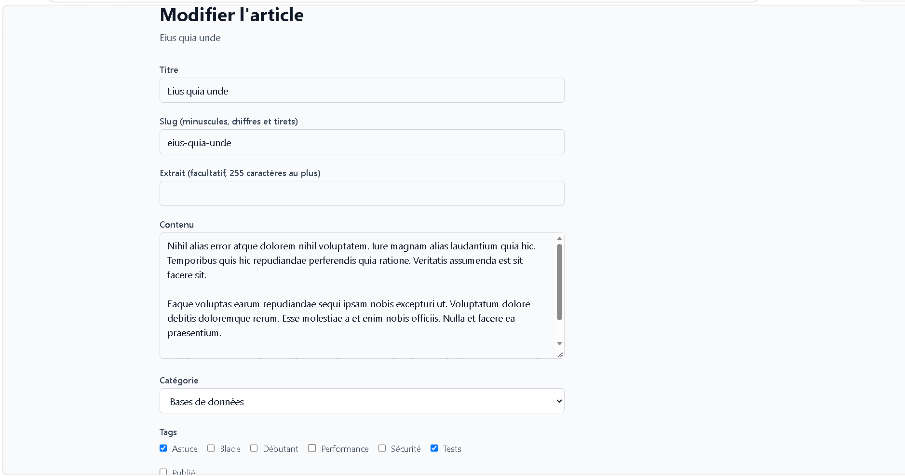
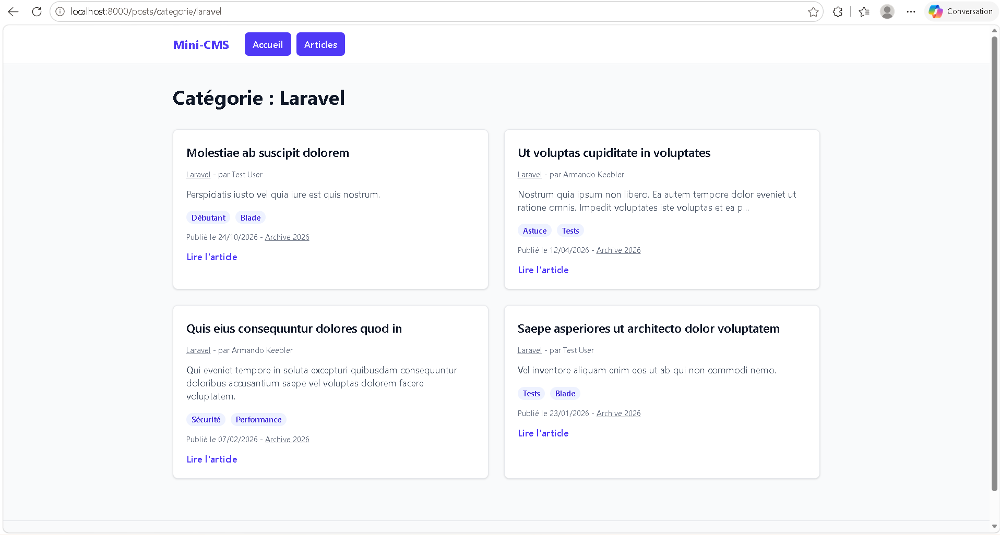

## État actuel (tag lab-04b)

- Formulaires d'article : catégorie (liste déroulante) et tags (cases à cocher, synchronisés avec `sync()`).
- Pages publiques par catégorie et par tag, liées par slug (`{category:slug}`, `{tag:slug}`).
- Accueil : catégories et tags populaires comptés avec `withCount`, articles publiés seulement.
- Tests Pest : `PostPagesTest`, `PostWriteTest`, `PostRelationsTest` et `PostTaxonomyTest`.

## Routes disponibles

| Méthode | URI | Nom | Action |
|---|---|---|---|
| GET | `/` | `home` | `PageController@home` |
| GET | `/a-propos` | `about` | `PageController@about` |
| GET | `/heure` | `time` | `PageController@time` |
| GET | `/posts` | `posts.index` | `PostController@index` |
| GET | `/posts/archive/{year}` | `posts.archive` | `PostController@archive` |
| GET | `/posts/categorie/{category:slug}` | `posts.category` | `PostController@byCategory` |
| GET | `/posts/tag/{tag:slug}` | `posts.tag` | `PostController@byTag` |
| GET | `/posts/create` | `posts.create` | `PostController@create` |
| POST | `/posts` | `posts.store` | `PostController@store` |
| GET | `/posts/{post}` | `posts.show` | `PostController@show` |
| GET | `/posts/{post}/edit` | `posts.edit` | `PostController@edit` |
| PUT | `/posts/{post}` | `posts.update` | `PostController@update` |
| DELETE | `/posts/{post}` | `posts.destroy` | `PostController@destroy` |
| PATCH | `/posts/{post}/publication` | `posts.publication` | `PostController@togglePublication` |
### Session 06

### Session 07

### Session 08

