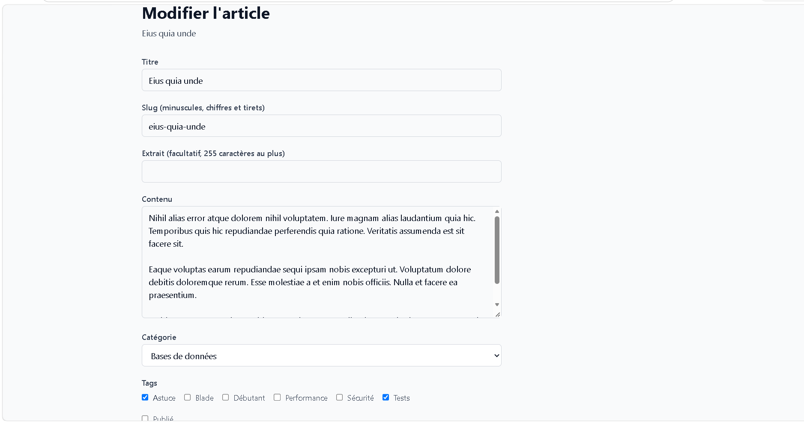
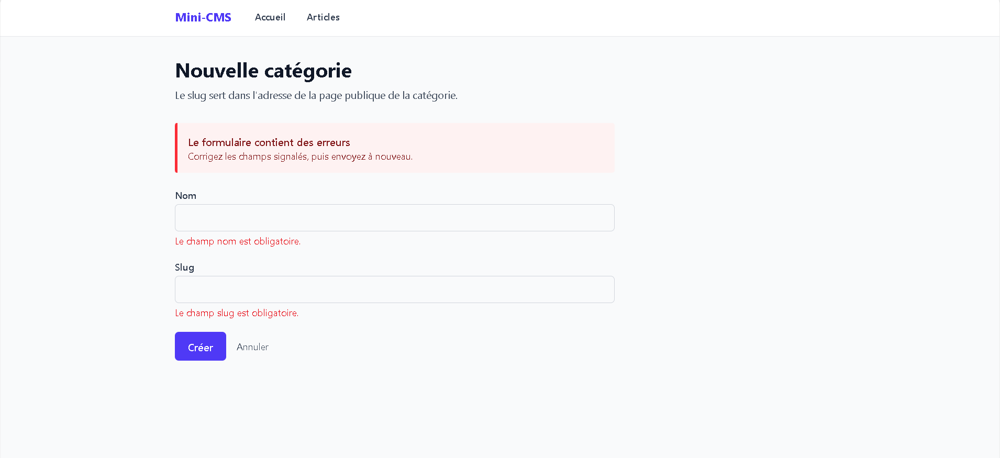
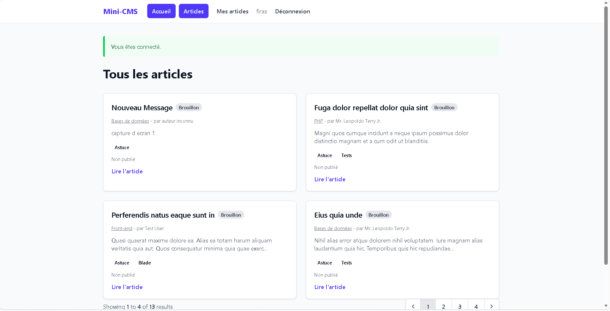

## État actuel (tag lab-06)

- Comptes écrits à la main : inscription (`/inscription`), connexion (`/connexion`) et déconnexion, avec `Hash::make`, `Auth::attempt` et la régénération de la session.
- Colonne `role` (`author` par défaut, `admin`). Après `php artisan migrate:fresh --seed`, le compte de démonstration `test@example.com` (mot de passe `password`) est administrateur.
- Écritures et back-office réservés aux utilisateurs connectés (middleware `auth`) ; chaque nouvel article est attaché à son auteur.
- Gate `manage-categories` : seuls les administrateurs gèrent les catégories.
- `PostPolicy` : un auteur modifie et supprime ses articles, un administrateur tous les articles.
- Page « Mes articles » (`/mes-articles`) et case « Se souvenir de moi » sur la connexion.
- Tests Pest : `PostPagesTest`, `PostWriteTest`, `PostRelationsTest`, `PostTaxonomyTest`, `PostFeedbackTest`, `CategoryAdminTest`, `ErrorPagesTest`, `AuthTest` et `AuthorizationTest`.

## Routes disponibles

| Méthode | URI | Nom | Action |
|---|---|---|---|
| GET | `/` | `home` | `PageController@home` |
| GET | `/a-propos` | `about` | `PageController@about` |
| GET | `/heure` | `time` | `PageController@time` |
| GET | `/posts` | `posts.index` | `PostController@index` |
| GET | `/posts/archive/{year}` | `posts.archive` | `PostController@archive` |
| GET | `/posts/categorie/{category:slug}` | `posts.category` | `PostController@byCategory` |
| GET | `/posts/tag/{tag:slug}` | `posts.tag` | `PostController@byTag` |
| GET | `/posts/create` | `posts.create` | `PostController@create` |
| POST | `/posts` | `posts.store` | `PostController@store` |
| GET | `/posts/{post}` | `posts.show` | `PostController@show` |
| GET | `/posts/{post}/edit` | `posts.edit` | `PostController@edit` |
| PUT | `/posts/{post}` | `posts.update` | `PostController@update` |
| DELETE | `/posts/{post}` | `posts.destroy` | `PostController@destroy` |
| PATCH | `/posts/{post}/publication` | `posts.publication` | `PostController@togglePublication` |
| GET | `/admin/categories` | `admin.categories.index` | `CategoryController@index` |
| GET | `/admin/categories/create` | `admin.categories.create` | `CategoryController@create` |
| POST | `/admin/categories` | `admin.categories.store` | `CategoryController@store` |
| GET | `/admin/categories/{category}/edit` | `admin.categories.edit` | `CategoryController@edit` |
| PUT | `/admin/categories/{category}` | `admin.categories.update` | `CategoryController@update` |
| DELETE | `/admin/categories/{category}` | `admin.categories.destroy` | `CategoryController@destroy` |
| GET | `/admin/tags` | `admin.tags.index` | `TagController@index` |
| GET | `/admin/tags/create` | `admin.tags.create` | `TagController@create` |
| POST | `/admin/tags` | `admin.tags.store` | `TagController@store` |
| GET | `/admin/tags/{tag}/edit` | `admin.tags.edit` | `TagController@edit` |
| PUT | `/admin/tags/{tag}` | `admin.tags.update` | `TagController@update` |
| DELETE | `/admin/tags/{tag}` | `admin.tags.destroy` | `TagController@destroy` |
| GET | `/inscription` | `register` | `Auth\RegisterController@create` |
| POST | `/inscription` | `register.store` | `Auth\RegisterController@store` |
| GET | `/connexion` | `login` | `Auth\LoginController@create` |
| POST | `/connexion` | `login.store` | `Auth\LoginController@store` |
| POST | `/deconnexion` | `logout` | `Auth\LoginController@destroy` |
| GET | `/mes-articles` | `my-posts` | `PostController@myPosts` |
### Session 06

### Session 07

### Session 08

### Session 09

### Session 10

Back-office des catégories et des tags, messages de validation en français, pages 404 et 503 dans le layout du site.

### Session 11

## Comparaison avec le Starter Kit Livewire

### Architecture de l'authentification

**Mini-CMS (ce projet)**
- Authentification « classique » : contrôleurs `LoginController`, `RegisterController` avec `Auth::attempt()`, régénération de session, remember token géré manuellement.
- Middleware `auth` sur les routes protégées, middleware `admin` (`EnsureUserIsAdmin`) pour la zone `/admin`.
- Un seul guard `web` (session/cookie), pas de fortify/sanctum/breeze.

**Laravel Livewire Starter Kit** (`laravel/livewire-starter-kit`)
- Utilise **Laravel Breeze** (ou **Laravel Jetstream** selon la version) comme base d'authentification.
- **Fortify** en arrière-plan pour les actions d'authentification (login, register, password reset, email verification, two-factor).
- **Sanctum** pour l'API token (SPA + mobile).
- Composants Livewire/Blade pour l'UI (forms, modals, validation temps réel).
- Two-factor authentication (2FA) intégré, confirmation de mot de passe pour actions sensibles.

### Autorisations

**Mini-CMS**
- **Middleware de route** : `auth` puis `admin` (alias dans `bootstrap/app.php`) pour fermer `/admin/*`.
- **Gates** : `manage-categories`, `manage-tags` (simples closures `fn (User $u) => $u->isAdmin()`).
- **Policy** : `PostPolicy` avec `view`, `create`, `update`, `delete` ; l'autorisation dépend de l'instance (`$post->user_id`).
- **Form Requests** : `authorize()` appelle le Gate/Policy (`$this->user()->can('update', $post)` ou `Gate::allows('manage-tags')`).
- **Vues** : `@can('manage-categories')`, `@can('manage-tags')` pour masquer/afficher les liens.
- **Tests** : `actingAs()`, `assertForbidden()`, `assertRedirect(route('login'))`, `Gate::forUser($user)->allows(...)`.

**Laravel Livewire Starter Kit**
- **Policies** : même concept (`PostPolicy`, `UserPolicy`), mais souvent enregistrées via `AuthServiceProvider::$policies` ou découvertes automatiquement (Laravel 11+).
- **Gates** : définis dans `AuthServiceProvider::boot()` ou via la syntaxe `Gate::define()`.
- **Middleware** : `auth` + `verified` (email vérifié) + rôles via **Spatie Laravel Permission** ou Gates custom.
- **Livewire Components** : `#[Authorized]` ou `$this->authorize()` dans les méthodes `mount()`, `save()`, `delete()`.
- **Blade** : même `@can`, `@cannot`, `@auth`, `@guest`.
- **Tests** : même API Pest (`actingAs`, `assertForbidden`, `assertRedirect`).

### Différences clés

| Aspect | Mini-CMS | Livewire Starter Kit |
|--------|----------|---------------------|
| **Auth backend** | Contrôleurs manuels + `Auth::attempt()` | Fortify (actions decouplées) |
| **API tokens** | Non | Sanctum (SPA + mobile) |
| **2FA** | Non | Oui (Fortify) |
| **Email verification** | Non | Oui (middleware `verified`) |
| **Password confirmation** | Non | Oui (pour actions sensibles) |
| **UI Auth** | Blade simple | Composants Livewire/Blade interactifs |
| **Autorisation** | Gates + Policies + Middleware | Même stack, mais souvent Spatie Permission pour rôles |
| **Tests** | Pest, assertions manuelles | Pest, même API, parfois plus de tests fournis |

### Ce que Mini-CMS a fait « à la main » et que le Starter Kit fournit

1. **Routes d'auth** : `login`, `register`, `password.reset`, `email.verification`, `two-factor` — tout est prêt.
2. **Middleware `verified`** : force la vérification d'email avant d'accéder aux zones protégées.
3. **Password Confirm** : ré-entrer le mot de passe avant `destroy`, `update` sensibles.
4. **Two-Factor** : TOTP, recovery codes, UI Livewire.
5. **Session management** : logout other devices, log des sessions actives.
6. **Profile management** : mise à jour nom, email, mot de passe, avatar.
7. **Composants UI** : inputs avec validation temps réel, messages d'erreur, loading states.

### Ce que Mini-CMS garde comme intérêt pédagogique

- **Visibilité totale** : chaque ligne d'auth/autorisation est écrite, lisible, modifiable.
- **Pas de magie** : pas de Fortify/Sanctum en boîte noire ; on comprend le flux `Auth::attempt()` → session → middleware → Gate/Policy.
- **Tests explicites** : on écrit soi-même `actingAs`, `assertForbidden`, `Gate::forUser` — ça force à comprendre la différence entre 403 (connecté, pas le droit) et 302 vers `/login` (pas connecté).
- **Adaptabilité** : facile de remplacer par JWT, API tokens, ou un autre guard sans casser l'existant.

### Conclusion

Le **Starter Kit Livewire** est un **gain de temps énorme en production** : il livre l'auth complète (2FA, email verification, password confirm, sessions, profil) en quelques minutes, avec une UI Livewire moderne et accessible.

**Mini-CMS** sert à **comprendre les briques** : middleware, Gates, Policies, Form Requests, tests d'autorisation. Une fois ces concepts maîtrisés, migrer vers le Starter Kit (ou Fortify + Sanctum + Livewire) devient trivial — on sait exactement quoi remplacer et pourquoi.
